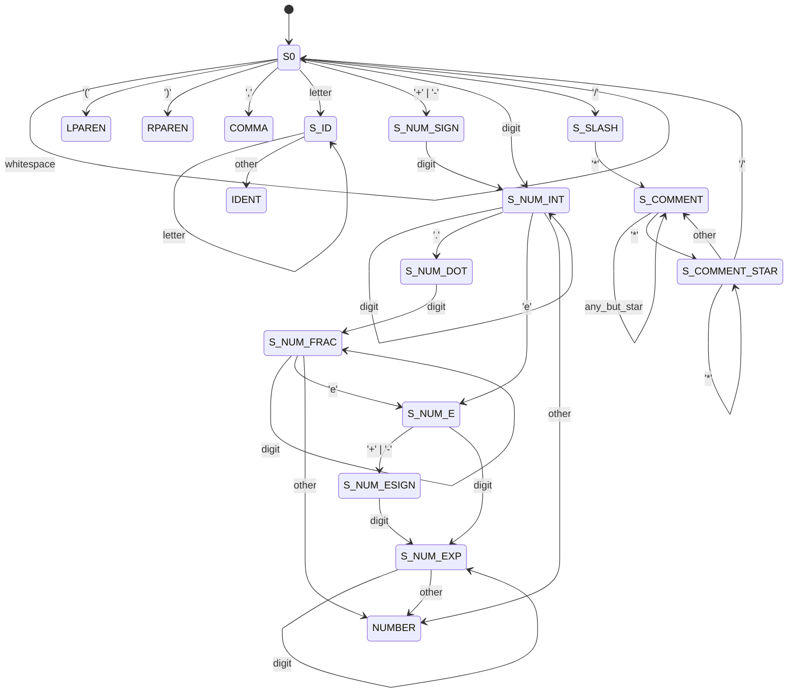

# Expression Transformation Project

**Author:** &lt;your full name, login&gt;
**Course:** Formal Languages and Compilers (IFJ / FLP equivalent)
**Date:** 2026

A compiler that reads a prefix function composition such as
`add(5, mul(3, sub(10, pow(6, 4))))` from standard input and writes the
equivalent infix mathematical expression `5 + 3 * (10 - 6^4)` to standard
output, using the minimum number of parentheses.

---

## Build and run

### On merlin.fit.vutbr.cz

The project is pure Python 3 and uses only the standard library — nothing to
compile. Merlin's `python3` is sufficient (Python 3.6+).

```sh
make test                      # run the full test suite
python3 expr.py < input.txt    # transform a single input
make run IN=tests/01_example1.in
```

### Makefile targets

| Target        | Effect                                               |
|---------------|------------------------------------------------------|
| `make`        | prints a short help message                          |
| `make test`   | runs `tests/run_tests.sh` against every test case    |
| `make run IN=…` | transforms a single input file                     |
| `make clean`  | removes `__pycache__` and the submission archive     |
| `make zip`    | builds `submission.zip` of all required files        |

### Debug entry points

```sh
python3 expr.py --tokens < input.txt   # dump the token stream
python3 expr.py --ast    < input.txt   # dump the parsed AST
```

### Exit codes

| Code | Meaning              |
|------|----------------------|
| 0    | success              |
| 2    | lexical error        |
| 3    | syntax error         |

Error messages are printed to `stderr` and carry 1-based `line:col` positions.

---

## Lexical analyser — finite automaton

The scanner is implemented as an explicit deterministic finite automaton
in `expr.py` (class `Lexer`). The accepting states for whole tokens are
**S_ID**, **S_NUM_INT**, **S_NUM_FRAC**, **S_NUM_EXP**, plus the single-char
final states for `(`, `)`, `,`.

```
                       whitespace
                       ┌───────┐
                       ▼       │
                     ┌───┐─────┘
            ┌────────┤ S0├────────┐
            │        └┬┬┬┬───────┐│
            │  '(' ')'',' │  │   ││
            │   emit      │  │   ││
            │ letter      │  │ '/' (comment)
            │   ▼         │  │   ▼
            │ ┌─────┐     │  │ ┌────────┐  '*'  ┌──────────┐
            │ │S_ID │─────┘  │ │S_SLASH ├──────▶│S_COMMENT │
            │ │letter│       │ └────────┘       │          │─loop any
            │ └──┬──┘        │                  └────┬─────┘
            │    │other -> IDENT emit                 '*'
            │    │                                    ▼
            │'+''-'                               ┌────────────┐
            │   ▼                                 │S_COMMENT_* │'/'→S0
            │ ┌───────────┐  digit                └────────────┘
            │ │S_NUM_SIGN │────────┐
            │ └───────────┘        │
            │                      ▼
            │ digit  ┌────────────┐ digit (loop)
            └──────▶│ S_NUM_INT  │────────┐
                    └────┬───┬───┘        │
                 '.'     │   │  'e'       │
                         ▼   ▼            │
                 ┌───────────┐  ┌────────┐│
                 │ S_NUM_DOT │  │ S_NUM_E││
                 └─────┬─────┘  └──┬──┬──┘│
                 digit │      '+'─'-'│ digit
                       ▼            ▼  ▼  │
                 ┌───────────┐  ┌──────────┐
                 │S_NUM_FRAC │  │S_NUM_ESIGN│
                 │ loop digit│  └────┬─────┘
                 └────┬──────┘       │ digit
                 'e'  │              ▼
                      └──▶ S_NUM_E ──▶ S_NUM_EXP (loop digit)

   Any accepting state on "other" character → emit NUMBER token.
```

The equivalent in Mermaid (renders on GitHub / in VS Code):



Rejected: a `+`/`-` sign not glued to a digit; a `.` not followed by a digit;
uppercase `E` in an exponent; an unterminated `/* …`.

---

## Implementation details

- **Language / libraries:** Python 3, standard library only. No third-party
  packages, no parser generators. The lexer, the parser, the AST, and the
  pretty-printer are all implemented from scratch in a single file
  (`expr.py`, ~250 LOC).
- **Lexical analysis:** explicit DFA (above) encoded as a state loop inside
  `Lexer.next_token`. Whitespace and `/* … */` block comments are skipped
  silently.
- **Syntax analysis:** recursive-descent parser over the prefix grammar
  ```
  expr ::= NUMBER | IDENT '(' expr (',' expr)+ ')'
  ```
  Function names are validated against a fixed table, which also supplies
  each operator's infix symbol, precedence (1–4), and associativity.
- **AST:** two node kinds — `Num` (keeps the original numeric lexeme so that
  `5e2` round-trips as `5e2`, not `500.0`) and `Op` (symbol, precedence,
  associativity, child list of length 2 or 3).
- **Pretty-printer:** rendering is a post-order walk. A child is wrapped in
  parentheses iff its precedence is lower than the parent's, or equal but
  on the "wrong" side for the parent's associativity (left child of a
  right-assoc operator, or right child of a left-assoc one). The middle
  operand of `?:` is never wrapped.
- **Spacing:** `+ - * / %` are printed with surrounding single spaces;
  `^` and `?:` are printed without spaces. This choice reproduces all four
  assignment examples byte-for-byte.

### Operator table

| Function | Symbol | Precedence | Associativity |
|----------|--------|------------|---------------|
| `tern`   | `?:`   | 1          | right         |
| `add`    | `+`    | 2          | left          |
| `sub`    | `-`    | 2          | left          |
| `mul`    | `*`    | 3          | left          |
| `div`    | `/`    | 3          | left          |
| `mod`    | `%`    | 3          | left          |
| `pow`    | `^`    | 4          | right         |

---

## Known behaviour and limitations

- **Signed-number lexeme adjacency.** Because `-5` is a single `NUMBER`
  token (per the given grammar), the input `sub(1, -5)` is printed as
  `1 - -5` — a valid math expression, but with two adjacent minus signs.
  Inserting parentheses around the right operand would be visually nicer
  but strictly unnecessary given the precedence rules, so the printer
  leaves the output as-is.
- **Comments do not nest.** `/* /* */ */` is treated as a single comment
  ending at the first `*/`, matching standard C semantics.
- No arithmetic evaluation is performed — this is a source-to-source
  translator, not a calculator.
- No unimplemented required parts.

---

## References and AI usage

- The project plan, the choice of parenthesisation rule, and parts of the
  README phrasing were developed with the assistance of an AI coding
  assistant (Claude Code). All code in `expr.py` was authored by hand with
  the author reviewing every line; no code was copied verbatim from
  external sources.
- No third-party libraries, no code copied from the internet, no parser
  generators used.
