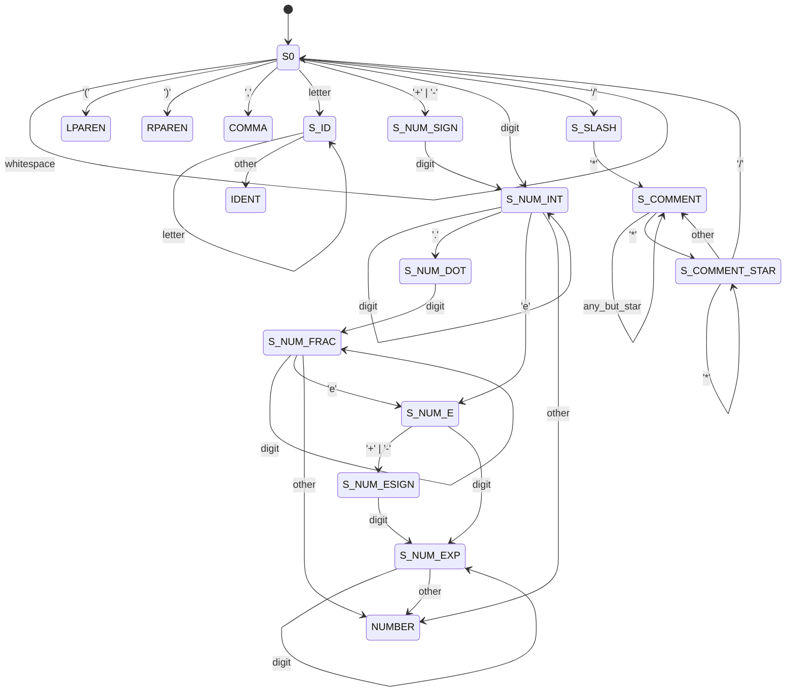

# Expression Transformation Project — Java

**Author:** &lt;your full name, login&gt;
**Course:** Formal Languages and Compilers
**Date:** 2026

A compiler that reads a prefix function composition such as
`add(5, mul(3, sub(10, pow(6, 4))))` from standard input and writes the
equivalent infix mathematical expression `5 + 3 * (10 - 6^4)` to standard
output, using the minimum number of parentheses.

This is the Java implementation. A functionally identical Python
implementation lives in the sibling `python/` directory.

---

## Build and run

### On merlin.fit.vutbr.cz

Pure Java SE, no third-party libraries. Any JDK 8 or newer works.

```sh
make                           # compile sources into out/
make test                      # run the full test suite
java -cp out Expr < input.txt  # transform a single input
make run IN=tests/01_example1.in
```

### Makefile targets

| Target        | Effect                                              |
|---------------|-----------------------------------------------------|
| `make`        | compiles `src/*.java` into `out/`                   |
| `make test`   | runs `tests/run_tests.sh` (builds first if needed)  |
| `make run IN=…` | transforms a single input file                    |
| `make clean`  | removes `out/` and the submission archive           |
| `make zip`    | builds `submission.zip` of all required files       |

### Debug entry points

```sh
java -cp out Expr --tokens < input.txt   # dump the token stream
java -cp out Expr --ast    < input.txt   # dump the parsed AST
```

### Exit codes

| Code | Meaning              |
|------|----------------------|
| 0    | success              |
| 2    | lexical error        |
| 3    | syntax error         |
| 4    | I/O error            |

Error messages are printed to `stderr` and carry 1-based `line:col` positions.

---

## Source layout

| File                | Role                                                    |
|---------------------|---------------------------------------------------------|
| `src/Expr.java`     | `main`: reads stdin, drives lexer→parser→printer        |
| `src/Lexer.java`    | explicit DFA; produces `Token` objects                  |
| `src/Token.java`    | token record with `Kind` enum + line/column             |
| `src/Parser.java`   | recursive-descent parser, function metadata table       |
| `src/Node.java`     | marker supertype of all AST nodes                       |
| `src/Num.java`      | numeric-literal AST leaf (keeps original lexeme)        |
| `src/Op.java`       | operator AST node (symbol, precedence, assoc, children) |
| `src/Printer.java`  | infix pretty-printer with min-parens rule               |
| `src/LexError.java` | lexical error with position                             |
| `src/ParseError.java` | syntax error with position                            |

---

## Lexical analyser — finite automaton

The scanner is an explicit deterministic finite automaton in
`Lexer.java`. Accepting (token-emitting) states: **S_ID**, **S_NUM_INT**,
**S_NUM_FRAC**, **S_NUM_EXP**, plus the single-char final states for
`(`, `)`, `,`.



Rejected: a `+`/`-` sign not glued to a digit; a `.` not followed by a digit;
uppercase `E` in an exponent; an unterminated `/* …`.

---

## Implementation details

- **Language / libraries:** Java SE, standard library only. No third-party
  packages, no parser generators.
- **Lexical analysis:** explicit DFA (above) encoded as a state loop inside
  `Lexer.nextToken`. Whitespace and `/* … */` block comments are skipped
  silently.
- **Syntax analysis:** recursive-descent parser over the prefix grammar
  ```
  expr ::= NUMBER | IDENT '(' expr (',' expr)+ ')'
  ```
  Function names are validated against a fixed `Map<String, FnInfo>`, which
  also supplies each operator's infix symbol, precedence (1–4), and
  associativity.
- **AST:** two node kinds — `Num` (keeps the original numeric lexeme so that
  `5e2` round-trips as `5e2`, not `500.0`) and `Op` (symbol, precedence,
  associativity, child list of length 2 or 3).
- **Pretty-printer:** rendering is a post-order walk. A child is wrapped in
  parentheses iff its precedence is lower than the parent's, or equal but
  on the "wrong" side for the parent's associativity (left child of a
  right-assoc operator, or right child of a left-assoc one). The middle
  operand of `?:` is never wrapped.
- **Spacing:** `+ - * / %` are printed with surrounding single spaces;
  `^` and `?:` are printed without spaces. Reproduces all four assignment
  examples byte-for-byte.

### Operator table

| Function | Symbol | Precedence | Associativity |
|----------|--------|------------|---------------|
| `tern`   | `?:`   | 1          | right         |
| `add`    | `+`    | 2          | left          |
| `sub`    | `-`    | 2          | left          |
| `mul`    | `*`    | 3          | left          |
| `div`    | `/`    | 3          | left          |
| `mod`    | `%`    | 3          | left          |
| `pow`    | `^`    | 4          | right         |

---

## Known behaviour and limitations

- **Signed-number lexeme adjacency.** Because `-5` is a single `NUMBER`
  token (per the given grammar), the input `sub(1, -5)` is printed as
  `1 - -5` — a valid math expression with two adjacent minus signs.
- **Comments do not nest.** `/* /* */ */` is treated as a single comment
  ending at the first `*/`, matching standard C semantics.
- No arithmetic evaluation is performed — this is a source-to-source
  translator, not a calculator.
- No unimplemented required parts.

---

## References and AI usage

- The project plan, the choice of parenthesisation rule, and parts of the
  README phrasing were developed with the assistance of an AI coding
  assistant (Claude Code). All Java code was authored and reviewed by the
  author; no code was copied verbatim from external sources.
- No third-party libraries, no code copied from the internet, no parser
  generators used.
